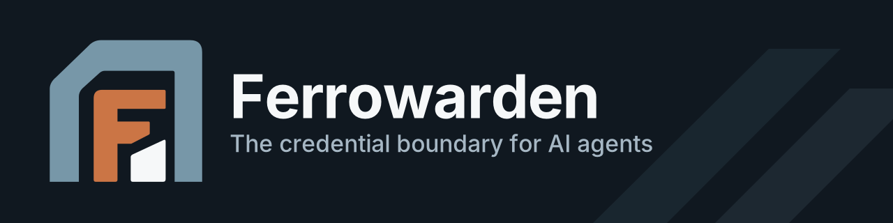

<picture>
  <source media="(prefers-color-scheme: light)" srcset="branding/assets/png/banners/ferrowarden-readme-light.png">
  
</picture>

# Ferrowarden

[](https://github.com/mallard1983/ferrowarden/actions/workflows/test.yml)
[](LICENSE)

**The credential boundary for AI agents.** Ferrowarden is a source-available credential proxy that sits alongside Vaultwarden. AI agents send requests using `{{vault:name}}` placeholders; Ferrowarden resolves credentials and forwards requests, without returning the secret values to the agent by design.

Ferrowarden resolves the credential by reading the vault itself (the [native backend](docs/native-vault.md): it keeps the vault encrypted and decrypts only the field a request needs, with no Bitwarden CLI or Node.js; even the one-shot that makes Vaultwarden's internal certificate is the same Rust binary), makes the outbound call, and scrubs known credential values from the response. The agent uses a scoped proxy key instead of direct vault access.

Ferrowarden is a **sidecar to [Vaultwarden](https://github.com/dani-garcia/vaultwarden)**, not a fork or replacement vault: Vaultwarden keeps storing your credentials. Ferrowarden is an independent project and is not affiliated with or endorsed by the Vaultwarden or Bitwarden projects.

---

## The Problem

An AI agent that manages infrastructure needs credentials — API tokens, passwords, service keys. Handing the agent a value puts it in the conversation context, where it can appear in prompts, model outputs, conversation history, logs or error messages.

## How Ferrowarden Approaches It

Ferrowarden gives the agent two things:

1. **A list of credential names** (`GET /v1/credentials`) — the agent learns which credentials it may use, not their values.
2. **A proxy endpoint** (`POST /v1/forward`) — the agent sends the API call it wants to make, using `{{vault:name}}` as a placeholder wherever a credential belongs. Ferrowarden substitutes the real value, makes the call, and returns the response with known credential values and common credential patterns scrubbed out.

The agent key is scoped to Ferrowarden's proxy endpoints. It does not give access to Vaultwarden, the vault CLI or any other service, and each key carries a default-deny policy limiting which credentials and HTTP methods it may use.

**What is in 0.2.0:** field placeholders (`{{vault:name:username}}`, custom fields, notes, TOTP), strict JSON input, default-deny scoped agent keys with a policy preview, a structured security event stream for SIEMs, and an optional admin web UI. See the [Changelog](CHANGELOG.md) for upgrade notes.

Ferrowarden narrows how credentials are exposed; it does not remove every risk. Scrubbing has limits, and a credential sent to a service that is allowed to receive it is in that service's hands. [Security Model](docs/security.md) covers the threat model and the limits.

---

## Architecture

```
  ┌─────────────────────────────────────────────────────────────┐
  │                        Host / Docker                         │
  │                                                             │
  │   ┌───────────┐   encrypted vault   ┌─────────────────────┐ │
  │   │ Vaultwarden│◄───────────────────│    Ferrowarden      │ │
  │   │ (storage)  │  HTTPS, internal   │ (credential proxy)  │ │
  │   └───────────┘  network only       └──────────┬──────────┘ │
  │                                                │            │
  └────────────────────────────────────────────────┼───────────┘
                                                   │ :3000
                                          ┌────────▼────────┐
                                          │   AI Agent      │
                                          │ (Claude, etc.)  │
                                          └─────────────────┘
```

The agent connects only to Ferrowarden. You manage credentials in Vaultwarden's web vault (published on `:8443`, or behind your reverse proxy), which works with Bitwarden-compatible clients. Ferrowarden holds the vault as ciphertext and decrypts only the one field a request needs, so no decrypted value ever crosses a network and there is no Bitwarden CLI or Node.js in the deployment.

---

## Quick Start

```sh
git clone https://github.com/mallard1983/ferrowarden.git
cd ferrowarden
```

### Try it in five minutes (test stack)

The setup scripts build a complete throwaway stack — Vaultwarden, Ferrowarden (with both vault backends) and a mock API — with a test account and fake credentials, then write the keys you need to `.env.test`:

```sh
./scripts/dev-setup.sh            # Linux/Mac
.\scripts\dev-setup.ps1           # Windows (PowerShell 7)

# Run the integration tests against it
set -a; . ./.env.test; set +a
cargo test --test integration -- --test-threads=1
```

### Production deployment

Upgrading from 0.1.0? The default stack no longer has a `bw-serve` container: see the [upgrade note](docs/release-notes/v0.2.0.md#upgrading). Still on `bw-serve` in 0.2.0? The backend is removed in 0.3.0: see [Upgrading from bw-serve](docs/native-vault.md#upgrading-from-bw-serve).

The full walkthrough, with Linux and Windows commands for every step, is in **[docs/setup.md](docs/setup.md)**. In outline:

```sh
# 0. A TLS certificate for Ferrowarden (EC P-256 with a SAN for the host agents use)
mkdir -p certs
openssl req -x509 -newkey ec -pkeyopt ec_paramgen_curve:P-256 -nodes -days 365 \
    -keyout certs/server.key -out certs/server.crt -subj "/CN=ferrowarden" \
    -addext "subjectAltName=DNS:localhost,IP:127.0.0.1"

# 1. Secrets: your future master password and an admin key
mkdir -p secrets
touch secrets/bw_client_id secrets/bw_client_secret
echo -n "your-vault-master-password" > secrets/bw_master_password
openssl rand -base64 48 | tr -dc 'A-Za-z0-9' | head -c 48 > secrets/ferrowarden_admin_key
# Linux hosts only — the container runs as UID 999 (ferrowarden):
sudo chown 999:999 certs/server.key secrets/bw_master_password secrets/ferrowarden_admin_key \n                   secrets/bw_client_id secrets/bw_client_secret
sudo chmod 600 secrets/* && sudo chmod 400 certs/server.key

# 2. Vaultwarden, with signups enabled just for creating your account.
#    The web vault is at https://127.0.0.1:8443 (cp .env.example .env to publish
#    it for a reverse proxy or your LAN and to set its URL).
VAULTWARDEN_SIGNUPS_ALLOWED=true docker compose up -d vaultwarden
#    In the web vault: create your account (same master password), then
#    Settings → Security → Keys → View API key (your personal API key) → write client_id and
#    client_secret into secrets/bw_client_id and secrets/bw_client_secret
#    (with sudo on Linux, since step 1 chowned them).
#    Add Login items; each item's Website URI is the only host it may be sent to.

# 3. Start everything (this also turns signups back off; the web vault stays
#    available for managing credentials — enable two-step login on your account)
docker compose up -d

# 4. Create an agent key — the token is shown ONCE
curl -s -X POST https://localhost:3000/v1/admin/keys --cacert certs/server.crt \
  -H "X-Admin-Key: $(cat secrets/ferrowarden_admin_key)" \
  -H "Content-Type: application/json"   -d '{"name": "my-agent", "credentials": ["my_api_*"], "methods": ["GET"]}'

# 5. Use the proxy (the item "my_api_token" must list https://api.example.com as a URI)
curl -s -X POST https://localhost:3000/v1/forward --cacert certs/server.crt \
  -H "X-Agent-Key: <token-from-step-4>" -H "Content-Type: application/json" \
  -d '{"request": {"method": "GET", "url": "https://api.example.com/status",
       "headers": {"Authorization": "Bearer {{vault:my_api_token}}"}}}'
```

Behind a TLS reverse proxy such as Pangolin, see [docs/tls.md](docs/tls.md#pangolin).

---

## Documentation

| Document | Contents |
|---|---|
| [Architecture](docs/architecture.md) | System design, data flow, component decisions |
| [Security Model](docs/security.md) | Threat model, security properties, limits, design rationale |
| [Setup Guide](docs/setup.md) | Installation, Vaultwarden setup, first run |
| [Deployment Profiles](docs/deployment-profiles.md) | The hardened container (scratch image, read-only, no capabilities) and the dedicated-VM profile with gVisor and outbound firewall rules, with what each does and does not protect against |
| [API Reference](docs/api-reference.md) | All endpoints, request/response shapes, error codes |
| [OpenAPI spec](docs/openapi.yaml) | OpenAPI 3.1 description of the agent and admin API; served at `GET /v1/openapi.json` to holders of a key |
| [Operations](docs/operations.md) | Unlock modes, key rotation, monitoring, troubleshooting |
| [Admin Web UI](docs/admin-ui.md) | Optional operator UI: Vaultwarden sign-in with two-step login, sessions, HTTPS and reverse proxy, lockouts |
| [Security Events](docs/events.md) | Structured event schema for SIEMs; Loki and Wazuh examples in [examples/siem](examples/siem/README.md) |
| [Logging](docs/logging.md) | Log levels, Loki, Wazuh, retention |
| [Notifications](docs/notifications.md) | Push notifications for blocked requests and security events (Gotify, ntfy, generic webhook): what is sent, rate limits, setup |
| [Metrics](docs/metrics.md) | Optional Prometheus endpoint on its own token-protected port: every metric, authentication and TLS, what is never a label, and a Grafana dashboard ([examples/grafana](examples/grafana/README.md)) |
| [TLS](docs/tls.md) | Pangolin reverse proxy and self-signed CA setup |
| [Agent Skill](docs/agent-skill.md) | Reference doc for agents using the proxy (non-skill format) |
| [MCP server](docs/mcp.md) | `ferrowarden-mcp`: MCP tools for agent harnesses, with install and configuration for Claude Code and Claude Desktop |
| [Roadmap](ROADMAP.md) | Planned work: approvals, MCP, OpenAPI, session tokens, agent SSH client |
| [Changelog](CHANGELOG.md) | Release notes and upgrade steps |
| [Security Policy](SECURITY.md) | How to report a vulnerability privately |
| [Contributing](CONTRIBUTING.md) | Development setup, checks, and pull request guidelines |

### Claude Code skill

If you use Claude Code, a ready-made skill is included at `.claude/skills/ferrowarden/`. Copy it to your personal skill directory to load it automatically whenever Claude needs to make a credentialed API call:

```sh
# Linux/Mac
cp -r .claude/skills/ferrowarden ~/.claude/skills/ferrowarden

# Windows (PowerShell)
Copy-Item -Recurse .claude\skills\ferrowarden $env:USERPROFILE\.claude\skills\ferrowarden
```

The skill covers endpoint schemas, placeholder syntax, error handling, and worked examples. It has `user-invocable: false` so Claude loads it automatically when the task involves credentialed API calls — no slash command needed.

---

## Security Summary

What Ferrowarden is designed to do, and where it stops:

- Credential values are stored in Vaultwarden (encrypted at rest). Ferrowarden does not keep its own copy of the vault; it keeps item names, ids and URIs in memory.
- In Ferrowarden's process, values are held as `Zeroizing<String>`, which overwrites the memory when the value is dropped. Copies in the HTTP stack's own buffers are outside its control.
- The agent key is accepted only by the proxy endpoints. It does not authenticate to the vault, and each key's policy is default-deny: it lists the credentials and HTTP methods the key may use.
- Each credential is bound to the hosts in its vault item's URIs; a request that would send it to another host is refused.
- Outbound targets are checked at DNS-resolution time: the vault endpoint is always refused, and private/internal addresses (including cloud metadata) are refused unless listed in `allowed_targets`.
- The admin key is enforced environment-only (minimum 32 characters); it cannot be set in a config file.
- Every security-relevant action is recorded as a structured security event (credential names, not values; failed authentication included) and can be shipped to stdout, a rotating file or syslog ([docs/events.md](docs/events.md)).
- Every credential value used in a request is scrubbed from the response body, headers and error messages (raw, JSON-escaped, URL-encoded and base64 forms), followed by common credential patterns.

Limits: scrubbing catches echoes and common patterns, not every transformation a target could apply. The proxy has to use the decrypted credential to make the call, so a compromised Ferrowarden host exposes credentials. Ferrowarden does not stop prompt injection, and no independent security audit has been published. [Security Model](docs/security.md) lists these and other limits.

To report a vulnerability, follow the [Security Policy](SECURITY.md); please don't open a public issue.

---

## Contributing

Contributions are welcome — bug reports, docs, tests and code. See [CONTRIBUTING.md](CONTRIBUTING.md) for the development setup, the checks to run before a pull request, and the extra bar for security-sensitive changes. Please report vulnerabilities privately as described in the [Security Policy](SECURITY.md), not in public issues.

---

## License

Ferrowarden is **source-available** under the [Functional Source License, Version 1.1, ALv2 Future License](LICENSE) (FSL-1.1-ALv2):

- You may use, copy, modify and redistribute it for any purpose **except a Competing Use**: offering it, or something substantially similar, to others as a commercial product or service.
- Self-hosting it for your own or your organisation's internal use, non-commercial education and research, and professional services for a licensee are explicitly permitted.
- Each release **becomes Apache-2.0 two years after it is published**.
- Releases up to and including **v0.1.0 remain under the MIT License** they were published with.

For commercial licensing, open an issue or contact the maintainer. Contributions are accepted under the [Contributor License Agreement](CLA.md).
