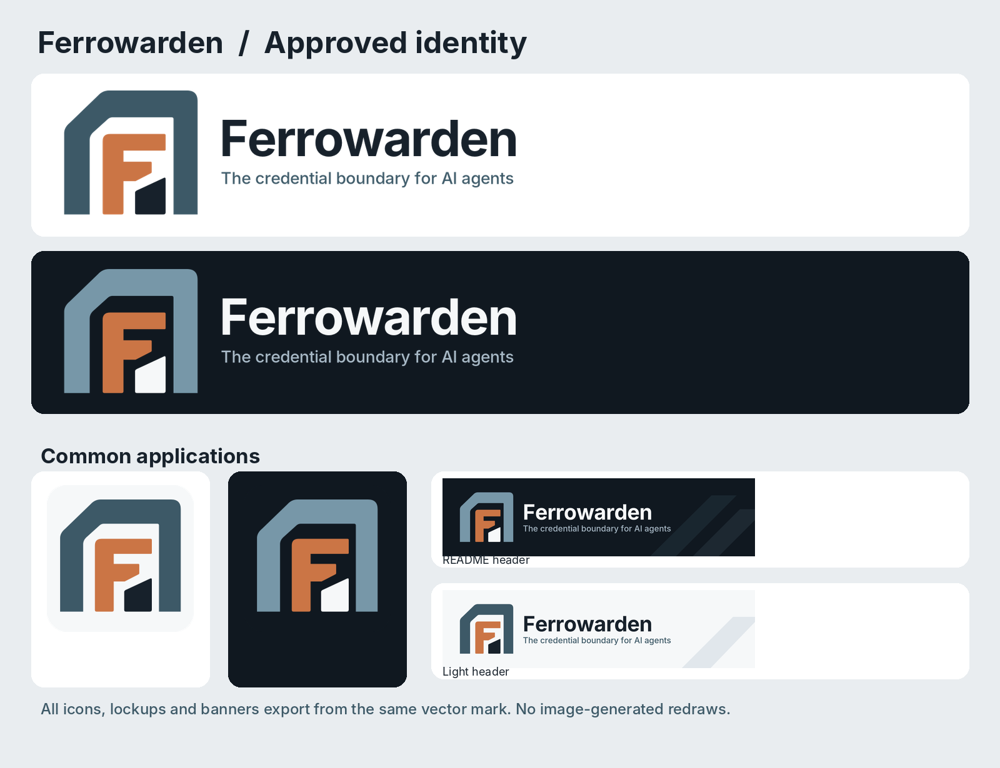

# Ferrowarden — Brand asset kit

**The credential boundary for AI agents**

This package contains editable, scalable logos and ready-to-use exported assets for the open-source [Ferrowarden](https://github.com/mallard1983/ferrowarden) project, plus written documentation. The design follows the **user-approved hybrid logo reference** included at `source/approved-reference.png`; the logo is **not** the earlier crenellated or original concept.



## Start here

1. Use `assets/png/banners/ferrowarden-readme-dark.png` for the GitHub README header.
2. Use `assets/favicons/github-avatar-512.png` for the GitHub organization/repository avatar, where supported.
3. Use `assets/svg/marks/ferrowarden-mark-light.svg` in light UI and `ferrowarden-mark-dark.svg` in dark UI.
4. Use `assets/svg/lockups/ferrowarden-lockup-light-tagline.svg` or `...dark-tagline.svg` for scalable primary lockups.
5. Read [BRAND_GUIDE.md](docs/BRAND_GUIDE.md) for the official design rules and [IMPLEMENTATION.md](docs/IMPLEMENTATION.md) for copy/paste integration snippets.

## Contents

| Location | Contents |
| --- | --- |
| `assets/svg/marks/` | Editable SVG masters: light, dark, monochrome, and application tiles |
| `assets/svg/lockups/` | Editable-text horizontal and stacked SVG logos, with and without tagline |
| `assets/svg/lockups-outlined/` | Font-independent versions of the same lockups, with text converted to paths |
| `assets/svg/banners/` | Seven production-size vector banners, editable text |
| `assets/svg/banners-outlined/` | Font-independent vector banners, text outlined |
| `assets/png/icons/` | 16–1024 px transparent marks and application tiles |
| `assets/png/lockups/` | 630, 1260 and 2520 px raster lockups |
| `assets/png/banners/` | Seven PNG banners at exact published dimensions |
| `assets/favicons/` | Multi-size `.ico`, PNG favicons, Apple/Android and maskable icons, manifest and pinned tab |
| `tokens/` | CSS custom properties and JSON design tokens |
| `docs/` | Brand guide, catalog, usage rules, voice guide, implementation, maintenance and release QA |
| `source/` | Approved reference artwork for future visual checks |
| `scripts/build_assets.py` | Offline asset generation script, with editable vector path definitions |
| `previews/` | Contact sheet showing delivered assets in common applications |

## Official palette

| Role | Color |
| --- | --- |
| Iron | `#17212B` |
| Steel | `#3D5967` |
| Copper | `#CB7545` |
| Paper | `#F6F8F9` |
| Mist | `#A6B7C4` |
| Deep Iron | `#101820` |
| Dark-mark Steel (high contrast) | `#7797A8` |

All vector and raster exports come from the same three paths: the chamfered steel portal, the copper F and the small sloped gateway. The **light** gateway is Iron; the **dark** gateway is Paper. Fonts are *not* bundled; text uses Inter with system fallbacks.

## Rebuild

```bash
python -m pip install -r requirements.txt
python scripts/build_assets.py
```

The build does not require network access once its dependencies are installed. SVG logos are editable source assets; PNGs, ICO and contact sheet are generated exports. To regenerate optional outlined SVGs after a local Inter install, run `python scripts/outline_svg_text.py`. Avoid editing a PNG and treating it as a new logo master.

## License and naming

Ferrowarden's repository identifies its code as MIT licensed. This kit contains newly prepared project branding materials. The maintainer should confirm and publish the intended **artwork license and trademark usage policy** before distributing the assets independently; code licensing alone does not automatically resolve rights in the project name and mark. Never imply endorsement by the independent Vaultwarden or Bitwarden projects.

## Validation

Run `python scripts/check_assets.py` after regenerating to verify SVG syntax, expected PNG dimensions, the multiresolution favicon, documentation completeness and presence of outlined assets.
