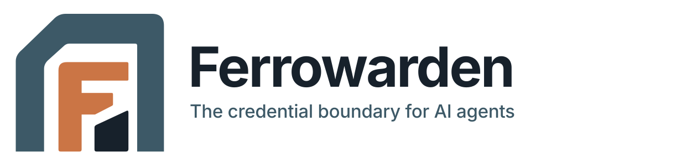
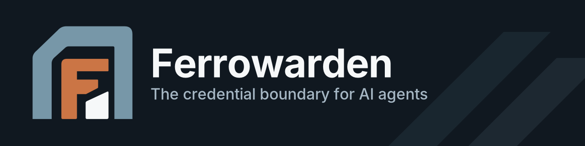

# Ferrowarden brand guide

**Version:** 1.0 (approved hybrid identity)  
**Brand name:** Ferrowarden  
**Official tagline:** **The credential boundary for AI agents**  
**Brand purpose:** Make credentialed automation useful without putting credential values in an AI agent's context.

> **Source of truth:** The logo selected by the project maintainer is included at [`../source/approved-reference.png`](../source/approved-reference.png). The source vector paths under `../assets/svg/marks/` reproduce its approved geometry. Do not replace it with the earlier fortress/battlement variants or with a generic padlock.

## 1. What Ferrowarden is

Ferrowarden is a **source-available credential proxy for AI agents**, deployed alongside Vaultwarden. An agent sends an outbound API request containing a named placeholder such as `{{vault:name}}`. Ferrowarden resolves the credential through the vault API layer, makes the outbound request, and scrubs credential values from the response before returning it. The agent receives a proxy-scoped credential rather than direct vault access.

**One-sentence description:** Ferrowarden lets AI agents use named credentials to make API calls without exposing credential values to the agent.

**Brand attributes:** engineered, dependable, restrained, technical, accessible, community-driven. The logo should feel like a boundary built into infrastructure, not an app for storing personal passwords.

## 2. Logo anatomy

The approved mark has three distinct parts:

| Part | Shape | Meaning | Color |
| --- | --- | --- | --- |
| Outer portal | Heavy steel shape with a diagonal upper-left shoulder, rounded top-right, and open interior | A fortified boundary and controlled gateway | Steel on light; lighter Steel on dark |
| Letterform F | Bold geometric F located *inside* the portal | Ferrowarden as the mediating service | Copper in all full-color variants |
| Gateway wedge | Small rising quadrilateral to the lower right of the F | Controlled onward access beyond the boundary | Iron on light; Paper on dark |

There are **no battlements**, extra inset frame, lock cylinder or surrounding badge in the official mark. The open interior/negative space is part of the drawing.

### Primary lockups

**On Paper / light surfaces**

**On Iron / dark surfaces**

Use the horizontal lockup with tagline on README headers, websites, presentation title frames and project documentation. Use the mark alone where the wordmark would be unreadable.

## 3. Color specification

| Token | HEX | Usage |
| --- | --- | --- |
| Iron | `#17212B` | Primary typography, light-background gateway, icons |
| Steel | `#3D5967` | Light-background outer portal, secondary headings |
| Copper | `#CB7545` | F symbol and limited highlights |
| Paper | `#F6F8F9` | Light surfaces; dark-background wordmark/gateway |
| Mist | `#A6B7C4` | Dark-background supporting copy |
| Deep Iron | `#101820` | Dark surfaces, banners and UI headers |
| Dark-mark Steel | `#7797A8` | Accessible light steel for the outer portal on Deep Iron |

**Default pairings**

- Light: Paper surface + Steel portal + Copper F + Iron gateway + Iron wordmark + Steel tagline.
- Dark: Deep Iron surface + Dark-mark Steel portal + Copper F + Paper gateway + Paper wordmark + Mist tagline.
- Monochrome: use all-Iron on pale backgrounds or all-Paper on dark backgrounds when color printing is unavailable. Preserve the separation between shapes.

### Accessibility

Approximate WCAG contrast ratios for common pairs are: Iron/Paper **15.30:1**; Steel/Paper **6.98:1**; Copper/Paper **3.20:1**; Mist/Deep Iron **8.68:1**; Dark-mark Steel/Deep Iron **5.77:1**; Paper/Deep Iron **16.80:1**. These ratios refer to foreground/background fills, not a guarantee that small symbol details remain visually recognizable.

**Do not set small copper text on Paper.** Copper is primarily the F identity/accent, not the standard paragraph text color. Use Iron or Steel for light-body copy and Paper/Mist for dark-body copy. Respect system reduced-motion preferences in any animated treatment.

## 4. Typography

| Role | Preferred typography | Guidance |
| --- | --- | --- |
| Logo name / hero title | Inter Bold / SemiBold | Title case: `Ferrowarden`; never all caps in the primary wordmark |
| Tagline | Inter Medium | Sentence case, directly beneath wordmark |
| UI section headings | Inter SemiBold | Concise, high-contrast |
| Body text | Inter Regular | Developer-readable language, 16 px base in web UIs |
| Technical examples | `ui-monospace`, `SFMono-Regular`, `Consolas`, monospace | Tokens, API paths, sample payloads |

The SVG lockups have editable text elements referencing `Inter` with fallbacks. Inter is an openly available typeface but **font files are deliberately not redistributed** in this kit. Install Inter locally if editing exported typography in a vector application.

## 5. Clear space and minimum sizes

- Maintain a clear space around the entire mark of at least **one third of the F stem width**, with a practical minimum of **10% of the icon's width**. On banners and cards, prefer 5–8% canvas margins.
- The mark must not touch text, borders, buttons or adjacent logos.
- **Icon alone:** 24 px minimum in normal UI; 32 px preferred. Provided 16 px favicon is an explicit exception due to browser constraints.
- **Lockup without tagline:** 280 px recommended minimum width.
- **Lockup with tagline:** 600 px minimum on standard-density displays so the supporting line remains legible. If space is smaller, use a plain lockup or icon only.
- Do not compress the icon, crop the F/wedge, or independently resize the inner elements.

## 6. Composition and backgrounds

The approved mark should retain its proportions and internal spacing regardless of output size. The wordmark and tagline are aligned as a single block to the right of the mark in the horizontal lockup. Use a stacked lockup only when the format calls for it.

**Approved backgrounds:** Paper; white; Deep Iron; Iron; muted light or dark neutral surfaces with sufficient contrast. Banners may use restrained diagonal steel shapes placed away from the logo. Avoid images or patterns under the tiny gap between F and gateway.

**Prohibited changes:** adding battlements, rotating the portal, making the F black on the approved full-color logo, changing the gateway into a solid wall, gradients that obscure symbol edges, glows, shadows, skewed proportions, saturated neon recolors, or substituting Vaultwarden's logo.

## 7. Brand tone

Use a restrained, competent, transparent engineering voice. Describe how the proxy works and what users control. Prefer specific architectural wording over generic security superlatives.

**Use:** “Credential values stay outside the agent's conversation context by design”; “Scoped agent keys”; “Named credential references”; “Proxy-mediated requests.”

**Avoid:** “Unhackable”; “Zero risk”; “Zero knowledge” (without a narrowly defined technical explanation); “Military-grade”; “Protects you from every prompt injection”; or claims that all network traffic and all integrated services are secured automatically.

See [VOICE_AND_MESSAGING.md](VOICE_AND_MESSAGING.md) for examples and claims guidance.

## 8. Recommended placements

| Placement | Approved artifact |
| --- | --- |
| README heading | `assets/png/banners/ferrowarden-readme-dark.png` |
| README heading on light | `assets/png/banners/ferrowarden-readme-light.png` |
| Docs site logo | `assets/svg/lockups/ferrowarden-lockup-light-plain.svg` |
| Dark UI | `assets/svg/marks/ferrowarden-mark-dark.svg` |
| Browser favicon | `assets/favicons/favicon.ico` |
| GitHub repository/organization avatar | `assets/favicons/github-avatar-512.png` |
| Open Graph and social links | `assets/png/banners/ferrowarden-social-og.png` |
| Application tile | `assets/png/icons/ferrowarden-tile-dark-512.png` |

For all files and dimensions, see [ASSET_CATALOG.md](ASSET_CATALOG.md). For markup and CSS, see [IMPLEMENTATION.md](IMPLEMENTATION.md).

## 9. Upstream relationship

Ferrowarden is a sidecar that works with Vaultwarden through the Bitwarden CLI (`bw serve`). It is its **own** project. The Ferrowarden identity must not imply that Vaultwarden, Bitwarden, or their maintainers designed, sponsor or officially endorse it unless they have explicitly confirmed that relationship.

## 10. Governance

Treat the icon path coordinates and primary colors as a coordinated identity. Update only after a conscious maintainer review, then regenerate all assets from the master script. Maintain the official tagline exactly as written unless the project intentionally revises its positioning.
